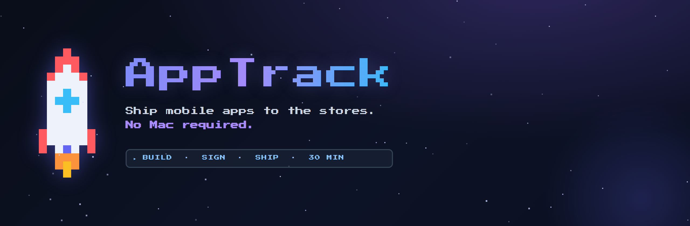
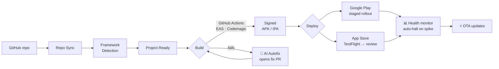
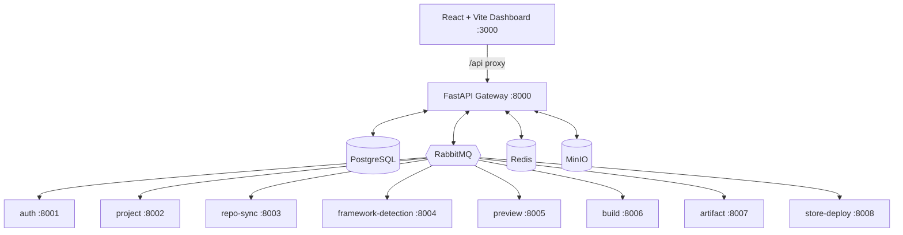

<div align="center">



<br/><br/>

# 📱 AppTrack

### Build, sign, and ship mobile apps to the App Store & Google Play — **in 30 minutes, without owning a Mac.**

*The open, self-hostable CI/CD & release platform for mobile teams. A modern alternative to Ionic Appflow.*

<sub>🤖 An **AI-native developer tool** — the self-healing pipeline uses your chosen LLM provider (**Claude**, **OpenAI**, Gemini & more — bring your own key) to fix build failures and open a PR.</sub>

<br/>

[](LICENSE)
[](#-supported-frameworks)
[](#-ios-without-a-mac)
[](#-features)
[](#-architecture)
[](#-architecture)
[](https://github.com/alidevai/apptrack/stargazers)

<br/>

**🌍 English · [🇹🇷 Türkçe](README.tr.md)**

**[Why AppTrack](#-why-apptrack) · [Product Tour](#-product-tour) · [Features](#-features) · [How it Works](#-how-it-works) · [Comparison](#-how-apptrack-compares) · [Quick Start](#-quick-start)**

</div>

---

## 💡 Why AppTrack

Shipping a mobile app to the stores is still painful: you juggle build farms, signing certificates, provisioning profiles and store APIs — and for iOS, you're told you **need a Mac.**

**AppTrack removes all of that.** Connect a GitHub repo, and AppTrack auto-detects your framework, builds it in the cloud, signs it, and ships it to the App Store and Google Play — from a single dashboard, self-hosted, on infrastructure you control.

> ### 🍏 iOS without a Mac
> AppTrack's founding purpose: let people **who don't own any Apple hardware** produce **signed iOS builds.** It routes iOS builds to cloud-hosted macOS runners (`macos-26`) and automates the entire signing chain — certificates, profiles, and store submission.

<div align="center">

| 😖 The old way | 🚀 With AppTrack |
|---|---|
| Buy a Mac for iOS builds | Cloud macOS runners — **no Mac needed** |
| Wrestle with certs & profiles | **Signing Doctor** diagnoses & auto-repairs |
| Build fails → debug for hours | **AI self-healing** opens a fix PR for you |
| Separate tools for build & deploy | **One platform**, idea → store |
| Per-seat SaaS pricing | **Self-host, bring your own keys** |

</div>

---

## 📸 Product Tour

<div align="center">

<br/><sub><b>The dashboard</b> — projects, builds, and health at a glance.</sub>
</div>

<br/>

<table>
<tr>
<td width="50%" valign="top" align="center">

<br/><b>One dashboard, every framework</b><br/>
<sub>Flutter, React Native, Expo — auto-detected and colour-coded, side by side.</sub>
</td>
<td width="50%" valign="top" align="center">

<br/><b>A visual pipeline, end to end</b><br/>
<sub>Repo → Framework → Build → Deploy, with live status and staged rollout controls.</sub>
</td>
</tr>
<tr>
<td width="50%" valign="top" align="center">

<br/><b>Costs & quotas, always visible</b><br/>
<sub>Built-in cost tracking and a generous free tier — no surprise bills.</sub>
</td>
<td width="50%" valign="top" align="center">

<br/><b>Clean, modern, self-hosted</b><br/>
<sub>Email or GitHub sign-in. Your data and credentials never leave your servers.</sub>
</td>
</tr>
</table>

<div align="center"><sub>🔎 See the full <a href="docs/assets/landing.png">marketing landing page</a> rendered from the app.</sub></div>

---

## ✨ Features

<table>
<tr>
<td width="50%" valign="top">

### 🏗️ Build anything
- **9 frameworks**, 6 languages, auto-detected
- GitHub Actions · EAS · Codemagic
- Cloud macOS for iOS — **no Mac required**
- Free provider fallback (GitHub Actions)

### 🔐 Secure by design
- Fernet-encrypted credential vault (zero plaintext)
- HMAC-verified, replay-protected webhooks
- Immutable, hash-chained audit log (SOC2-ready)
- **Network-isolated** microservices (internal-only ports)

### 🩺 Signing Doctor
- Project-scoped iOS signing diagnosis
- Detects cert/profile/bundle-id/expiry issues
- **One-click repair** — regenerate cert + profile

</td>
<td width="50%" valign="top">

### 🤖 AI-powered self-healing
- Build fails → **agentic AI opens a fix PR**
- Reads your repo, patches, validates, self-critiques
- **BYOK** — Claude · OpenAI · Gemini · OpenRouter · NVIDIA
- Any model, free or paid — your keys, your cost

### 🚦 Safe releases
- Staged rollout: 10% → 25% → 50% → 100%
- **Auto-halt** on error-rate / crash spikes
- Canary deploys with automatic rollback

### ⚡ OTA live updates
- Ship JS/HTML/CSS instantly — no rebuild, no review
- Channels: production · staging · beta
- Runtime-version matching + rollback

</td>
</tr>
</table>

---

## 📦 Supported Frameworks

<div align="center">

| Category | Frameworks | Build Provider |
|----------|-----------|----------------|
| **Native** | Swift · Kotlin | GitHub Actions (macOS `macos-26` for iOS) |
| **Cross-platform** | React Native · Flutter · Expo | EAS · Codemagic |
| **Hybrid** | Capacitor · Ionic · Cordova | GitHub Actions |
| **Web** | PWA (+ TWA for Android) | GitHub Actions |

**9 frameworks · 6 languages · one dashboard**

</div>

---

## 🔭 How it Works



Every asynchronous state transition flows through **RabbitMQ events** — services never call each other directly for state changes, so the pipeline is resilient and observable end-to-end.

---

## 🧱 Architecture



**Stack:** Python/FastAPI · SQLAlchemy 2.0 (async) · PostgreSQL · RabbitMQ · Redis · MinIO · React/TypeScript/Vite/Tailwind · Docker Compose. Microservice ports are network-isolated; only the gateway and dashboard are exposed.

---

## 🥊 How AppTrack Compares

**Our claim:** AppTrack is the only platform that is **self-hostable, multi-framework, AI-self-healing, and free to start** — all at once.

<div align="center">

| Capability | **AppTrack** | Ionic Appflow | Codemagic | EAS (Expo) | Bitrise |
|---|:---:|:---:|:---:|:---:|:---:|
| iOS builds without a Mac | ✅ | ✅ | ✅ | ✅ | ✅ |
| **Self-hostable** (your infra) | ✅ | ❌ | ❌ | ❌ | ❌ |
| **Free / low-cost tier** | ✅ | 🟡 limited | 🟡 limited | 🟡 limited | 🟡 limited |
| Multi-framework (9) | ✅ | 🟡 Ionic-first | ✅ | 🟡 Expo-first | ✅ |
| **AI self-healing** (writes fix PRs) | ✅ | ❌ | ❌ | ❌ | ❌ |
| **Bring-your-own AI keys** | ✅ | ❌ | ❌ | ❌ | ❌ |
| Signing Doctor (diagnose + repair) | ✅ | ❌ | 🟡 | 🟡 managed | ❌ |
| Staged rollout + auto-halt | ✅ | 🟡 | ❌ | 🟡 | ❌ |
| OTA live updates | ✅ | 🟡 paid | ❌ | ✅ | ❌ |
| Bring your own runners | ✅ | ❌ | ✅ | ❌ | ✅ |
| Built-in cost tracking | ✅ | 🟡 | 🟡 | 🟡 | 🟡 |

<sub>✅ built-in · 🟡 partial / paid / plan-gated · ❌ not available. Competitor capabilities as generally advertised; corrections welcome via PR.</sub>

</div>

---

## 🚀 Quick Start

```bash
# 1. Clone
git clone https://github.com/alidevai/apptrack.git
cd apptrack

# 2. Configure
cp .env.example .env      # fill in your secrets

# 3. Launch everything (Docker)
make dev

# 4. Open
#   Dashboard : http://localhost:3000
#   API docs  : http://localhost:8000/api/docs
#   RabbitMQ  : http://localhost:15672
#   MinIO     : http://localhost:9001
```

```bash
# Tests
make test            # backend (pytest) + frontend (vitest)
make lint-backend    # ruff
make lint-frontend   # eslint
```

---

## 🗺️ Roadmap

- ✅ Multi-provider AI gateway (BYOK) + selectable free/paid models
- ✅ Agentic autofix — AI reads repo, patches, validates, opens PR *(live-proven)*
- ✅ Signing Doctor (iOS signing diagnosis + one-click repair)
- ✅ Staged rollout + auto-halt, OTA updates, immutable audit
- 🔜 **AI App Factory** — describe an idea, AppTrack generates the app, you preview & publish
- 🔜 Signed IPA end-to-end demo · streaming AI · hosted runner wizard

---

## 🔒 Security

AppTrack is built security-first.

Highlights: Fernet credential encryption (PBKDF2, 100k iterations, key rotation) · HMAC-verified webhooks · immutable hash-chained audit log · SSRF-guarded outbound requests · builds isolated to your own repositories.

Found a vulnerability? Please **don't** open a public issue — see [SECURITY.md](SECURITY.md) and email **devaikaga@gmail.com**.

---

## 📬 Contact & License

Questions, commercial licensing, or partnership? **📧 devaikaga@gmail.com**

AppTrack is released under the **[PolyForm Noncommercial License 1.0.0](LICENSE)** — free to **use, modify, and share** for any **noncommercial** purpose (personal projects, research, education, evaluation). **Commercial use requires a separate license** — contact the email above.

<div align="center">
<br/>

### If AppTrack is useful to you, please ⭐ star the repo — it genuinely helps.

<sub>Built for mobile teams who'd rather ship than fight their toolchain.</sub>

</div>
