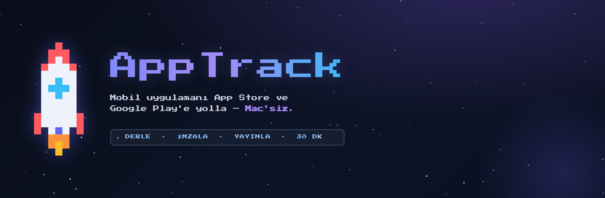
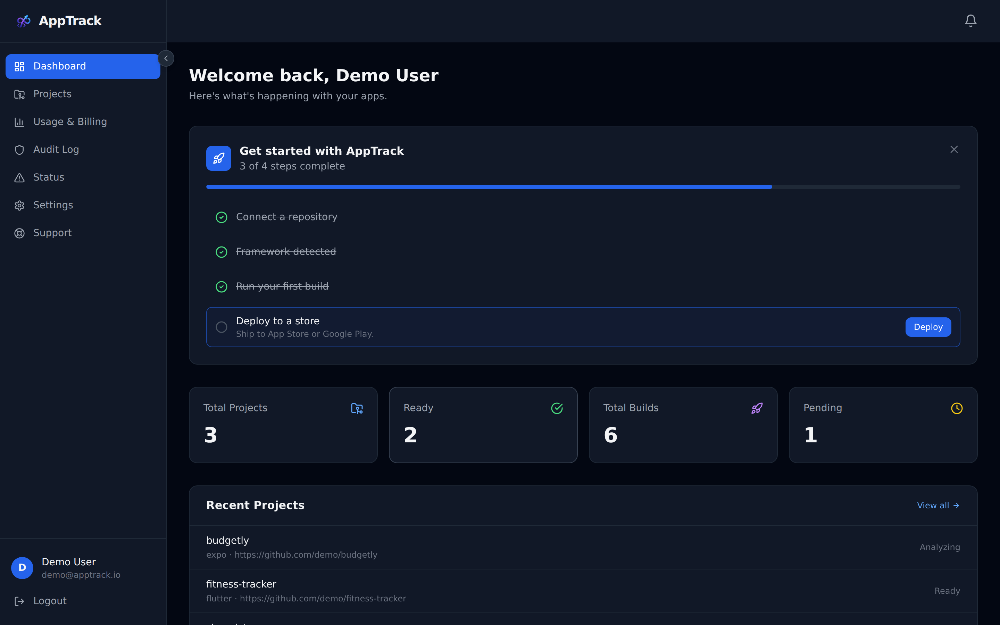
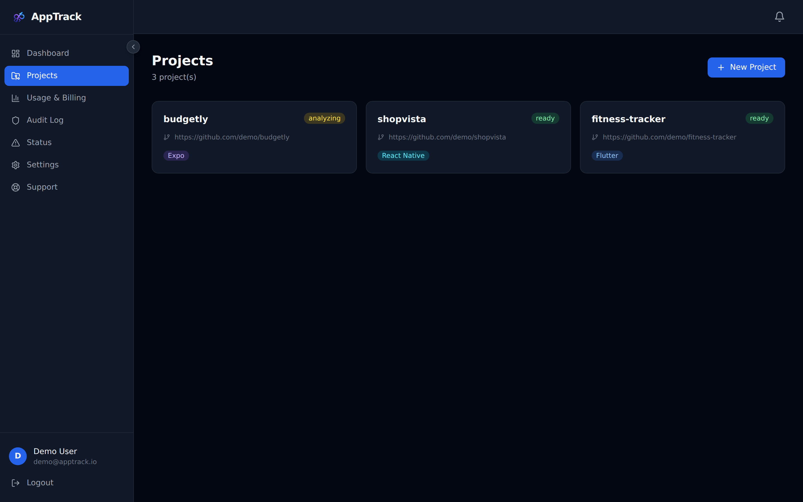
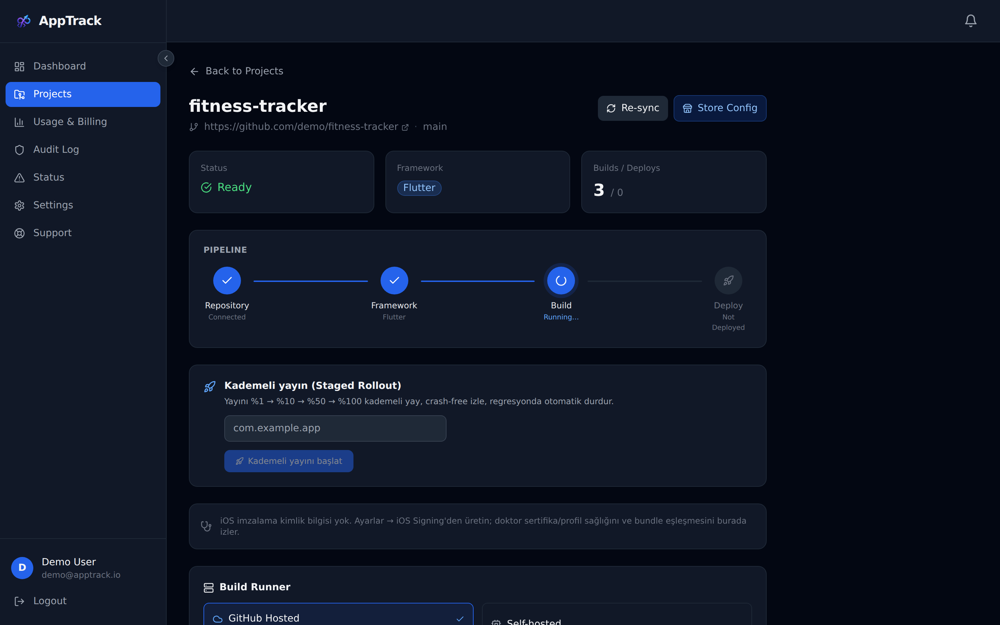
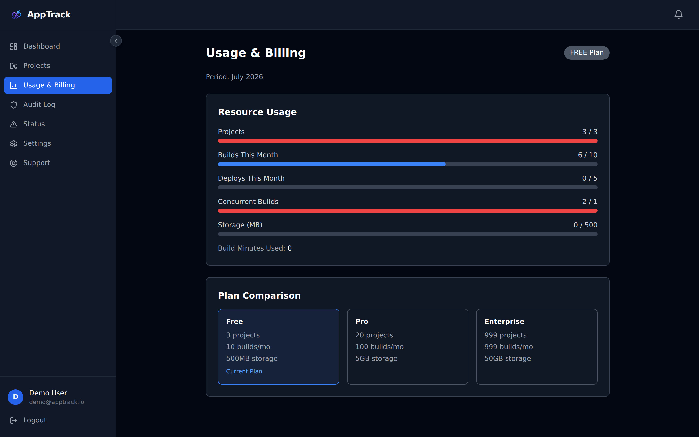
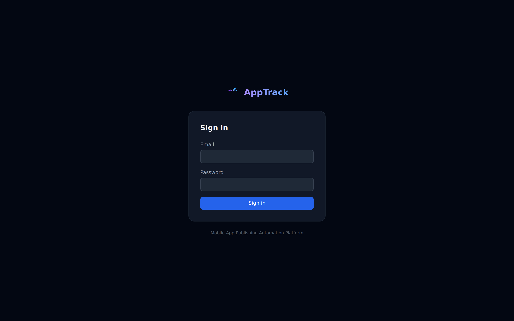
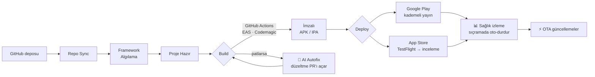
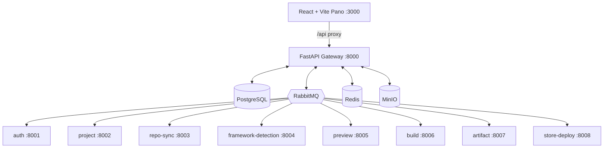

<div align="center">



<br/><br/>

# 📱 AppTrack

### Mobil uygulamalarını App Store ve Google Play'e **30 dakikada, Mac'in olmadan** derle, imzala ve yayınla.

*Mobil ekipler için açık, kendi sunucunda barındırılabilir CI/CD & yayın platformu. Ionic Appflow'un modern alternatifi.*

<br/>

[](LICENSE)
[](#-desteklenen-frameworkler)
[](#-mac-olmadan-ios)
[](#-özellikler)
[](#-mimari)
[](#-mimari)
[](https://github.com/holladevai/apptrack/stargazers)

<br/>

**[🌍 English](README.md) · 🇹🇷 Türkçe**

**[Neden AppTrack](#-neden-apptrack) · [Ürün Turu](#-ürün-turu) · [Özellikler](#-özellikler) · [Nasıl Çalışır](#-nasıl-çalışır) · [Karşılaştırma](#-apptrack-nasıl-kıyaslanır) · [Hızlı Başlangıç](#-hızlı-başlangıç)**

</div>

---

## 💡 Neden AppTrack

Bir mobil uygulamayı mağazalara göndermek hâlâ zahmetli: build çiftlikleri, imzalama sertifikaları, provisioning profilleri ve mağaza API'leriyle boğuşursun — ve iOS için sana **bir Mac gerekli** derler.

**AppTrack bunların hepsini ortadan kaldırır.** Bir GitHub deposu bağla; AppTrack framework'ünü otomatik algılar, bulutta derler, imzalar ve App Store ile Google Play'e gönderir — tek bir panodan, kendi kontrol ettiğin altyapıda, kendin barındırarak.

> ### 🍏 Mac olmadan iOS
> AppTrack'in kuruluş amacı: **hiç Apple donanımı olmayan** insanların **imzalı iOS build'leri** üretebilmesi. iOS build'lerini bulutta barındırılan macOS runner'lara (`macos-26`) yönlendirir ve tüm imzalama zincirini (sertifikalar, profiller, mağaza gönderimi) otomatikleştirir.

<div align="center">

| 😖 Eski yöntem | 🚀 AppTrack ile |
|---|---|
| iOS build için Mac satın al | Bulut macOS runner — **Mac gerekmez** |
| Sertifika & profillerle boğuş | **İmzalama Doktoru** teşhis eder & otomatik onarır |
| Build patlar → saatlerce hata ayıkla | **AI kendini iyileştirme** senin için düzeltme PR'ı açar |
| Build ve deploy için ayrı araçlar | **Tek platform**, fikir → mağaza |
| Kişi başı SaaS ücreti | **Kendin barındır, kendi anahtarlarını getir** |

</div>

---

## 📸 Ürün Turu

<div align="center">

<br/><sub><b>Pano</b> — projeler, build'ler ve sağlık tek bakışta.</sub>
</div>

<br/>

<table>
<tr>
<td width="50%" valign="top" align="center">

<br/><b>Tek pano, her framework</b><br/>
<sub>Flutter, React Native, Expo — otomatik algılanır, renk-kodlu, yan yana.</sub>
</td>
<td width="50%" valign="top" align="center">

<br/><b>Uçtan uca görsel pipeline</b><br/>
<sub>Repo → Framework → Build → Deploy; canlı durum ve kademeli yayın kontrolleri.</sub>
</td>
</tr>
<tr>
<td width="50%" valign="top" align="center">

<br/><b>Maliyet & kotalar hep görünür</b><br/>
<sub>Yerleşik maliyet takibi ve cömert bir ücretsiz katman — sürpriz fatura yok.</sub>
</td>
<td width="50%" valign="top" align="center">

<br/><b>Sade, modern, kendi sunucunda</b><br/>
<sub>E-posta veya GitHub ile giriş. Verilerin ve anahtarların sunucularından hiç çıkmaz.</sub>
</td>
</tr>
</table>

<div align="center"><sub>🔎 Uygulamadan üretilen tam <a href="docs/assets/landing.png">tanıtım sayfasını</a> gör.</sub></div>

---

## ✨ Özellikler

<table>
<tr>
<td width="50%" valign="top">

### 🏗️ Her şeyi derle
- **9 framework**, 6 dil, otomatik algılama
- GitHub Actions · EAS · Codemagic
- iOS için bulut macOS — **Mac gerekmez**
- Ücretsiz sağlayıcıya geri düşme (GitHub Actions)

### 🔐 Tasarımdan güvenli
- Fernet ile şifreli kimlik kasası (sıfır düz metin)
- HMAC doğrulamalı, tekrar-korumalı webhook'lar
- Değişmez, hash-zincirli denetim günlüğü (SOC2-hazır)
- **Ağ-izole** mikroservisler (yalnız-iç portlar)

### 🩺 İmzalama Doktoru
- Proje-bazlı iOS imza teşhisi
- Sertifika/profil/bundle-id/son-kullanma sorunlarını saptar
- **Tek tıkla onarım** — sertifika + profil yeniden üret

</td>
<td width="50%" valign="top">

### 🤖 AI destekli kendini iyileştirme
- Build patlar → **agentik AI bir düzeltme PR'ı açar**
- Repo'nu okur, yamalar, doğrular, öz-eleştiri yapar
- **BYOK** — Claude · OpenAI · Gemini · OpenRouter · NVIDIA
- Herhangi bir model, ücretsiz veya ücretli — senin anahtarın, senin maliyetin

### 🚦 Güvenli yayınlar
- Kademeli yayın: %10 → %25 → %50 → %100
- Hata-oranı / çökme sıçramasında **otomatik durdurma**
- Otomatik geri-alma ile canary deploy

### ⚡ OTA canlı güncellemeler
- JS/HTML/CSS'i anında gönder — yeniden derleme yok, inceleme yok
- Kanallar: production · staging · beta
- Runtime-sürüm eşleştirme + geri-alma

</td>
</tr>
</table>

---

## 📦 Desteklenen Framework'ler

<div align="center">

| Kategori | Framework'ler | Build Sağlayıcı |
|----------|-----------|----------------|
| **Native** | Swift · Kotlin | GitHub Actions (iOS için macOS `macos-26`) |
| **Çapraz platform** | React Native · Flutter · Expo | EAS · Codemagic |
| **Hibrit** | Capacitor · Ionic · Cordova | GitHub Actions |
| **Web** | PWA (+ Android için TWA) | GitHub Actions |

**9 framework · 6 dil · tek pano**

</div>

---

## 🔭 Nasıl Çalışır



Her asenkron durum geçişi **RabbitMQ olaylarından** akar — servisler durum değişiklikleri için birbirini doğrudan çağırmaz, böylece pipeline dayanıklı ve uçtan uca izlenebilirdir.

---

## 🧱 Mimari



**Teknoloji:** Python/FastAPI · SQLAlchemy 2.0 (async) · PostgreSQL · RabbitMQ · Redis · MinIO · React/TypeScript/Vite/Tailwind · Docker Compose. Mikroservis portları ağ-izole; yalnız gateway ve pano dışarı açıktır.

---

## 🥊 AppTrack Nasıl Kıyaslanır

**İddiamız:** AppTrack, **kendi sunucunda barındırılabilir, çok-framework'lü, AI ile kendini iyileştiren ve ücretsiz başlanabilir** tek platform — hepsi aynı anda.

<div align="center">

| Yetenek | **AppTrack** | Ionic Appflow | Codemagic | EAS (Expo) | Bitrise |
|---|:---:|:---:|:---:|:---:|:---:|
| Mac olmadan iOS build | ✅ | ✅ | ✅ | ✅ | ✅ |
| **Kendi sunucunda barındırma** | ✅ | ❌ | ❌ | ❌ | ❌ |
| **Ücretsiz / düşük-maliyet katman** | ✅ | 🟡 sınırlı | 🟡 sınırlı | 🟡 sınırlı | 🟡 sınırlı |
| Çok-framework (9) | ✅ | 🟡 Ionic-öncelikli | ✅ | 🟡 Expo-öncelikli | ✅ |
| **AI kendini iyileştirme** (düzeltme PR'ı) | ✅ | ❌ | ❌ | ❌ | ❌ |
| **Kendi AI anahtarını getir** | ✅ | ❌ | ❌ | ❌ | ❌ |
| İmzalama Doktoru (teşhis + onarım) | ✅ | ❌ | 🟡 | 🟡 yönetimli | ❌ |
| Kademeli yayın + oto-durdur | ✅ | 🟡 | ❌ | 🟡 | ❌ |
| OTA canlı güncelleme | ✅ | 🟡 ücretli | ❌ | ✅ | ❌ |
| Kendi runner'ını getir | ✅ | ❌ | ✅ | ❌ | ✅ |
| Yerleşik maliyet takibi | ✅ | 🟡 | 🟡 | 🟡 | 🟡 |

<sub>✅ yerleşik · 🟡 kısmi / ücretli / plana bağlı · ❌ mevcut değil. Rakip yetenekleri genel olarak ilan edildiği şekilde; düzeltmeler PR ile memnuniyetle karşılanır.</sub>

</div>

---

## 🚀 Hızlı Başlangıç

```bash
# 1. Klonla
git clone https://github.com/holladevai/apptrack.git
cd apptrack

# 2. Yapılandır
cp .env.example .env      # sırlarını doldur

# 3. Her şeyi başlat (Docker)
make dev

# 4. Aç
#   Pano      : http://localhost:3000
#   API doküman: http://localhost:8000/api/docs
#   RabbitMQ  : http://localhost:15672
#   MinIO     : http://localhost:9001
```

```bash
# Testler
make test            # backend (pytest) + frontend (vitest)
make lint-backend    # ruff
make lint-frontend   # eslint
```

---

## 🗺️ Yol Haritası

- ✅ Çok-sağlayıcılı AI ağ geçidi (BYOK) + seçilebilir ücretsiz/ücretli modeller
- ✅ Agentik autofix — AI repo'yu okur, yamalar, doğrular, PR açar *(canlı kanıtlı)*
- ✅ İmzalama Doktoru (iOS imza teşhisi + tek-tık onarım)
- ✅ Kademeli yayın + oto-durdur, OTA güncelleme, değişmez denetim
- 🔜 **AI App Factory** — bir fikir anlat, AppTrack uygulamayı üretsin, önizle & yayınla
- 🔜 İmzalı IPA uçtan-uca demo · streaming AI · barındırılan runner sihirbazı

---

## 🔒 Güvenlik

AppTrack güvenlik-öncelikli tasarlanmıştır.

Öne çıkanlar: Fernet kimlik şifreleme (PBKDF2, 100k iterasyon, anahtar rotasyonu) · HMAC doğrulamalı webhook'lar · değişmez hash-zincirli denetim günlüğü · SSRF-korumalı çıkış istekleri · build'ler kendi depolarına izole.

Bir zafiyet mi buldun? Lütfen **herkese açık issue AÇMA** — [SECURITY.md](SECURITY.md)'ye bak ve **devaikaga@gmail.com** adresine e-posta at.

---

## 📬 İletişim & Lisans

Sorular, ticari lisanslama veya ortaklık? **📧 devaikaga@gmail.com**

AppTrack **[PolyForm Noncommercial License 1.0.0](LICENSE)** ile yayınlanır — her türlü **ticari olmayan** amaç için (kişisel projeler, araştırma, eğitim, değerlendirme) **kullanabilir, değiştirebilir ve paylaşabilirsin**. **Ticari kullanım ayrı bir lisans gerektirir** — yukarıdaki e-postadan iletişime geç.

<div align="center">
<br/>

### AppTrack işine yarıyorsa lütfen ⭐ depoyu yıldızla — gerçekten yardımcı oluyor.

<sub>Araç zinciriyle boğuşmaktansa ürün göndermeyi tercih eden mobil ekipler için üretildi.</sub>

</div>
